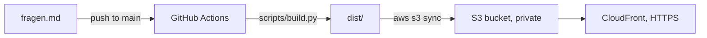

# Der echte Einbürgerungstest

https://d366lkc1yz71i4.cloudfront.net

A static website with a humorous, unofficial quiz about German everyday culture, habits and regional quirks – the things no textbook teaches you.

> **Note:** This is a fun, unofficial quiz and **not** the official German naturalization test (Einbürgerungstest). Some customs vary by region.

## Overview

The quiz contains 12 multiple-choice questions (in German) covering topics such as the *Weißwurstäquator*, Bavarian beer garden etiquette, the Swabian *Kehrwoche*, *Moin* and *Stoßlüften*. Each question has four answer options, one correct answer and a short explanation.

The website is fully static (HTML, CSS, JavaScript) and requires no backend, which makes it cheap and simple to host on AWS.

## How It Works



`scripts/build.py` parses and validates `fragen.md`, writes `dist/questions.json` and copies the site files into `dist/`. The quiz shows questions in a fixed order and the explanation right after each answer.

## Project Structure

| Path | Description |
|------|-------------|
| `fragen.md` | Source of all quiz questions, answers and explanations |
| `site/` | Static quiz UI (`index.html`, `style.css`, `app.js`) |
| `scripts/build.py` | Validates `fragen.md` and builds the site into `dist/` (standard library only) |
| `infra/template.yaml` | CloudFormation: private S3 bucket, CloudFront with OAC, GitHub OIDC deploy role |
| `.github/workflows/deploy.yml` | Builds on every push/PR, deploys on push to `main` |

## Local Development

Requires Python 3.10+.

```bash
python scripts/build.py
python -m http.server 8000 -d dist
```

Then open http://localhost:8000 in your browser.

## Deployment on AWS

### 1. Create the infrastructure (once)

```bash
aws cloudformation deploy \
  --stack-name einbuergerungstest \
  --template-file infra/template.yaml \
  --capabilities CAPABILITY_IAM \
  --parameter-overrides GitHubRepo=<owner>/<repo>
```

`GitHubRepo` must match the repository part of the OIDC `sub` claim exactly. Newer GitHub repositories include IDs, e.g. `owner@27291885/repo@1448132503`.

If your AWS account already has a GitHub OIDC provider (`token.actions.githubusercontent.com`), also pass `ExistingOidcProviderArn=<arn>`.

Read the outputs:

```bash
aws cloudformation describe-stacks --stack-name einbuergerungstest --query "Stacks[0].Outputs"
```

### 2. Configure GitHub

In the repository under **Settings > Secrets and variables > Actions > Variables**, add:

| Variable | Value |
|----------|-------|
| `AWS_REGION` | Region of the stack, e.g. `eu-central-1` |
| `AWS_ROLE_ARN` | `DeployRoleArn` output |
| `S3_BUCKET` | `BucketName` output |
| `CLOUDFRONT_DISTRIBUTION_ID` | `DistributionId` output |

No AWS access keys are stored in GitHub. The workflow authenticates via OIDC, and only the `main` branch may assume the deploy role.

### 3. Deploy

Push to `main`. The site is available at the `WebsiteUrl` output (`https://<id>.cloudfront.net`).

### Costs

At low traffic the setup stays within the CloudFront free tier (1 TB transfer and 10M requests per month); S3 storage for a few KB is negligible. The distribution uses `PriceClass_100` (North America and Europe edges).

## Adding or Editing Questions

Questions are maintained in [fragen.md](fragen.md). Each question follows this format:

```markdown
### N. Question text?

- A) Option
- B) Option
- C) Option
- D) Option

**Richtige Antwort:** B

**Erklärung:** Short explanation.
```

The build fails if a question is missing an option, the answer or the explanation, so a broken edit is never deployed. The answer key table at the end of the file is ignored by the build.
