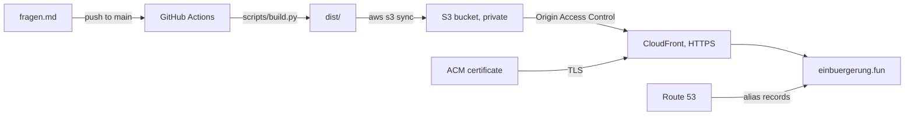

# Der echte Einbürgerungstest

https://einbuergerung.fun

A static website with a humorous, unofficial quiz about German everyday culture, habits and regional quirks – the things no textbook teaches you.

> **Note:** This is a fun, unofficial quiz and **not** the official German naturalization test (Einbürgerungstest). Some customs vary by region.

## Overview

`fragen.md` holds a pool of questions (in German) covering topics such as the *Weißwurstäquator*, Bavarian beer garden etiquette, the Swabian *Kehrwoche*, *Moin* and *Stoßlüften*. Each question has four answer options, one correct answer and a short explanation.

Like the official test, each attempt consists of 33 questions. They are drawn at random from the pool in the browser, so every attempt – and every click on *Neuen Test mit neuen Fragen starten* – gives a different selection in a different order. The quiz size lives in `QUIZ_SIZE` in `scripts/build.py`.

The website is fully static (HTML, CSS, JavaScript) and requires no backend, which makes it cheap and simple to host on AWS.

## How It Works



`scripts/build.py` parses and validates `fragen.md`, writes `dist/questions.json` (the full pool plus `quizSize`) and copies the site files into `dist/`. The browser draws the 33 questions for an attempt and shows the explanation right after each answer.

## Project Structure

| Path | Description |
|------|-------------|
| `fragen.md` | Source of all quiz questions, answers and explanations |
| `site/` | Static quiz UI (`index.html`, `style.css`, `app.js`) |
| `scripts/build.py` | Validates `fragen.md` and builds the site into `dist/` (standard library only) |
| `infra/template.yaml` | CloudFormation: private S3 bucket, CloudFront with OAC, GitHub OIDC deploy role |
| `.github/workflows/deploy.yml` | Builds on every push/PR, deploys on push to `main` |

## Local Development

Requires Python 3.10+.

```bash
python scripts/build.py
python -m http.server 8000 -d dist
```

Then open http://localhost:8000 in your browser.

## Deployment on AWS

### 1. Create the infrastructure (once)

```bash
aws cloudformation deploy \
  --stack-name einbuergerungstest \
  --template-file infra/template.yaml \
  --capabilities CAPABILITY_IAM \
  --parameter-overrides GitHubRepo=<owner>/<repo>
```

`GitHubRepo` must match the repository part of the OIDC `sub` claim exactly. Newer GitHub repositories include IDs, e.g. `owner@27291885/repo@1448132503`.

If your AWS account already has a GitHub OIDC provider (`token.actions.githubusercontent.com`), also pass `ExistingOidcProviderArn=<arn>`.

Read the outputs:

```bash
aws cloudformation describe-stacks --stack-name einbuergerungstest --query "Stacks[0].Outputs"
```

### 2. Configure GitHub

In the repository under **Settings > Secrets and variables > Actions > Variables**, add:

| Variable | Value |
|----------|-------|
| `AWS_REGION` | Region of the stack, e.g. `eu-central-1` |
| `AWS_ROLE_ARN` | `DeployRoleArn` output |
| `S3_BUCKET` | `BucketName` output |
| `CLOUDFRONT_DISTRIBUTION_ID` | `DistributionId` output |

No AWS access keys are stored in GitHub. The workflow authenticates via OIDC, and only the `main` branch may assume the deploy role.

### 3. Deploy

Push to `main`. The workflow syncs `dist/` to S3 and invalidates the CloudFront cache, so the new content is live within a minute or two.

## Production Environment

| | |
|---|---|
| Primary URL | https://einbuergerung.fun |
| Alternative URL | https://www.einbuergerung.fun |
| CloudFront URL | https://d366lkc1yz71i4.cloudfront.net |
| CloudFormation stack | `einbuergerungstest` |
| S3 bucket | `einbuergerungstest-sitebucket-alduqfwslkc7` (`eu-north-1`) |
| CloudFront distribution | `EJIRIFCF11ECT` |
| Certificate region | `us-east-1` (required by CloudFront) |
| AWS project | `Einbuergerung` in the `vvkorz-team` organization |
| Domain registrar | IONOS (registration and renewal only) |
| DNS | Amazon Route 53 public hosted zone `einbuergerung.fun` |

Console access runs through AWS Builder ID: sign in at https://settings.aws.com, open **Projects > Einbuergerung**, then the AWS Management Console. The project uses the AWS-managed `AccountFullAccessRole`; accounts created through AWS Settings do not necessarily have an `OrganizationAccountAccessRole`.

### Custom Domain

The domain stays registered with IONOS, but its nameservers point at the Route 53 hosted zone, which is authoritative for DNS:

```text
ns-1122.awsdns-12.org
ns-314.awsdns-39.com
ns-681.awsdns-21.net
ns-1562.awsdns-03.co.uk
```

The hosted zone holds eight records: `NS` and `SOA` for the zone, `A`/`AAAA` alias records for `einbuergerung.fun` and `www.einbuergerung.fun` pointing at the distribution, and two ACM validation `CNAME`s. The alias records resolve CloudFront's edge IPs dynamically — never replace them with literal IP addresses, and never delete the validation records, because ACM needs them to renew the certificate automatically.

HTTPS is terminated at CloudFront with an Amazon-issued ACM certificate (RSA 2048, DNS validation) in `us-east-1` covering both names. No IONOS certificate is involved. DNS only resolves names; once resolved, the browser talks to CloudFront directly.

> **Drift warning:** the domain was wired up in the AWS Console on 26 November 2026 — a Route 53 hosted zone, an ACM certificate, the two alternate domain names on the distribution and the alias records. `infra/template.yaml` does not describe any of this yet, so redeploying the stack as-is would strip the custom domain from the distribution. Add `Aliases` and `ViewerCertificate` to the template before the next `cloudformation deploy`.

Routine content updates touch none of this: they only write to S3 and invalidate the cache.

### Costs

At low traffic the setup stays within the CloudFront free tier (1 TB transfer and 10M requests per month); S3 storage for a few KB is negligible. The distribution uses `PriceClass_100` (North America and Europe edges). The custom domain adds the Route 53 hosted zone at about $0.50 per month (alias queries to CloudFront are free) on top of the annual IONOS registration; the ACM certificate is free.

### Diagnostics

```bash
# Which account am I actually in?
aws sts get-caller-identity

# DNS delegation and resolution
dig einbuergerung.fun NS +short
dig einbuergerung.fun A +short
dig +trace einbuergerung.fun

# HTTPS, the www variant and the HTTP redirect
curl -I https://einbuergerung.fun
curl -I https://www.einbuergerung.fun
curl -I http://einbuergerung.fun

# CloudFront on its own, bypassing custom DNS
curl -I https://d366lkc1yz71i4.cloudfront.net
```

| Symptom | Likely cause |
|---|---|
| Domain does not resolve | Nameserver delegation at IONOS or missing alias records |
| CloudFront URL works, custom domain does not | Alternate domain names or DNS |
| Certificate error | Wrong or unattached ACM certificate on the distribution |
| Certificate stuck pending validation | Missing ACM `CNAME` records |
| HTTP 403 | Missing object, bucket policy or OAC |
| Stale content | CloudFront cache not invalidated |
| `AccessDenied` from the CLI | Wrong account or role |

## Adding or Editing Questions

Questions are maintained in [fragen.md](fragen.md). Each question follows this format:

```markdown
### N. Question text?

- A) Option
- B) Option
- C) Option
- D) Option

**Richtige Antwort:** B

**Erklärung:** Short explanation.
```

The build fails if a question is missing an option, the answer or the explanation, or if the pool holds fewer than `QUIZ_SIZE` questions – so a broken edit is never deployed. The answer key table at the end of the file is ignored by the build.

Question numbers only order the pool; players see their own numbering. In the subtitle, `{quiz_size}` and `{pool_size}` are replaced at build time, so adding questions needs no edit there.
